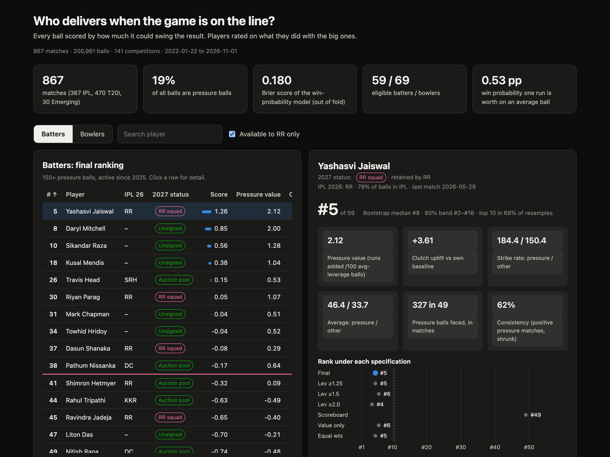

# Who delivers when the game is on the line?

A pressure rating for T20 batters and bowlers, built for **SupeRR Selector Season 2 (Rajasthan Royals), Round 1**.

**Live dashboard → https://rohanfouzdar.github.io/superr-pressure-index/**
Open it with only players RR can sign: [batters](https://rohanfouzdar.github.io/superr-pressure-index/#rr) · [bowlers](https://rohanfouzdar.github.io/superr-pressure-index/#rr-bowl)

## The idea

Pressure isn't the same as the death overs. Needing 108 off 10 balls looks tense, but the game is already gone. Needing 13 off 7 with four wickets left is real pressure.

So every ball is scored by how much it could swing the result. Players are then rated on what they did with the big ones, compared with an average player in the same spot.

## Top 10 under pressure

| # | Batters | Bowlers |
|---|---|---|
| 1 | Shreyas Iyer | Josh Hazlewood |
| 2 | Tilak Varma | Rashid Khan |
| 3 | Ishan Kishan | Krunal Pandya |
| 4 | Tim David | Sunil Narine |
| 5 | Yashasvi Jaiswal | Tushar Deshpande |
| 6 | Rohit Sharma | Wanindu Hasaranga |
| 7 | Phil Salt | Mujeeb Ur Rahman |
| 8 | Daryl Mitchell | Akeal Hosein |
| 9 | Abhishek Sharma | Pat Cummins |
| 10 | Sikandar Raza | Matheesha Pathirana |

## How it works

1. **Win probability.** One model per innings, trained on 200,961 balls from IPL and T20I matches, 2022 to 2026. Each ball is scored by a model that never saw its match. Brier score 0.180.
2. **Leverage.** For each ball, how much the next ball could move win probability. The average ball is 1. A pressure ball is 1.5 or more, ×1.25 in knockouts. About one ball in five qualifies.
3. **Value.** The win probability a player adds, divided by the leverage they faced, in runs per 100 balls. Small samples are pulled towards average.
4. **Score.** 0.65 × pressure value + 0.20 × lift over usual level + 0.15 × consistency, averaged over three pressure cut-offs.

Across five alternative cut-offs and weightings, 7–9 of the top 10 batters and 8–9 of the top 10 bowlers stay in.

## What you can do on the dashboard

- Switch between batters and bowlers, sort by any column, and search for a player.
- Click a player to see their pressure numbers against their usual level, and their rank under each definition.
- Tick **Available to RR only** to see who RR can actually sign at the 16 Dec auction. This is based on the 17 Nov 2026 retention lists.
- Change the score weights and see how much of the top 10 holds.

## Files

| File | What it is |
|---|---|
| `index.html` | The dashboard. A single file with no dependencies. |
| `preview.png` | The screenshot above. |

All ratings come from the supplied competition data pack. Retention news is used only for the RR availability view.
